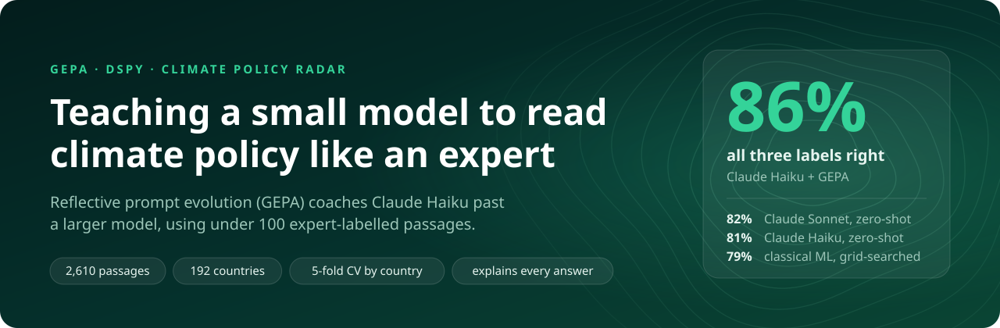
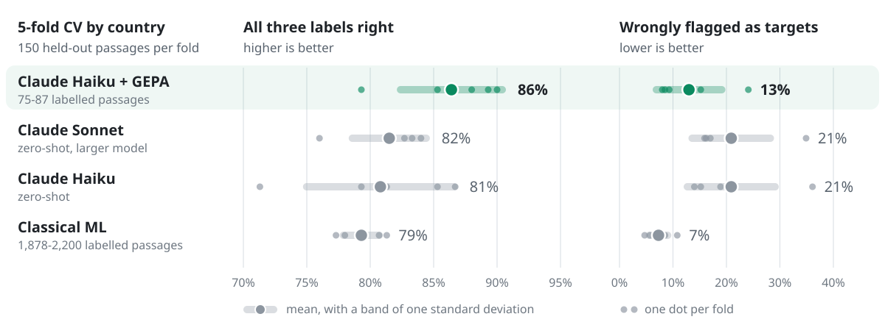
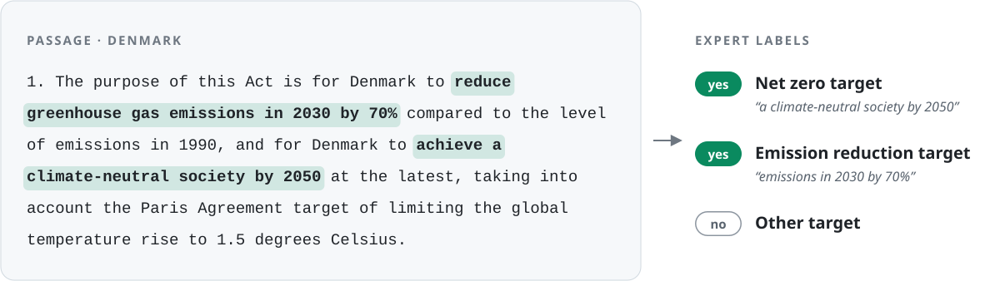
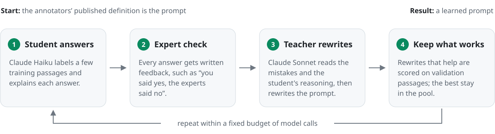
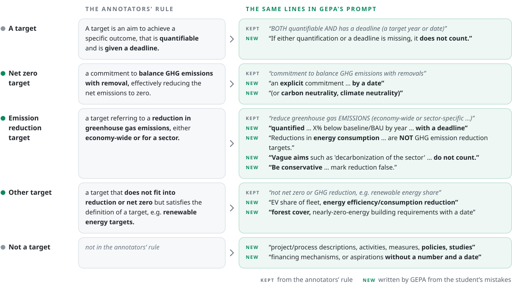

<p align="center">
  
</p>

<p align="center">
  <a href="gepa_climate_targets.ipynb"></a>
  
  
  
  
  
  <a href="https://vedpiyush93-stack.github.io/GEPA_Climate_Policy/"></a>
</p>

<p align="center">
  <b>Can a small, cheap language model learn an expert's judgment from under 100 labelled examples,<br>and explain its answers?</b>
</p>

<br>

<picture>
  <source media="(prefers-color-scheme: dark)" srcset="assets/kpi-dark.svg">
  
</picture>

## The result

<picture>
  <source media="(prefers-color-scheme: dark)" srcset="assets/results-dark.svg">
  
</picture>

- **A coached small model beats a bigger one.** GEPA lifts Claude Haiku from 81% to **86%** of passages with all three labels right, ahead of Claude Sonnet (82%) in 5 of 5 folds.
- **Few labels.** GEPA used 75-87 labelled passages per fold. Classical machine learning (ML) trained on 1,878-2,200 and reached 79%.
- **Fewer false alarms.** Passages wrongly flagged as containing a target fall from 21% to 13%. Classical ML flags the fewest (7%) but gets fewer passages fully right.
- **It explains itself.** Every answer comes with its reasoning in plain language ([example below](#see-it-explain-an-answer)).

> [!NOTE]
> Every number on this page is replayed from model responses cached in `cache/dspy`. Re-running the notebook makes **zero new LLM calls** and reproduces each figure exactly.

<details>
<summary><b>Numbers behind the chart</b></summary>

<br>

| Setup | Labelled passages | How it was built | All 3 labels right (mean ± SD) | Wrongly flagged as targets |
|---|---|---|---|---|
| Claude Haiku + GEPA | 75-87 per fold | same small model; GEPA rewrote its prompt, with Claude Sonnet as the teacher | **86% ± 4%** | 13% |
| Claude Sonnet | 0 | zero-shot: same prompt, larger model | 82% ± 3% | 21% |
| Claude Haiku | 0 | zero-shot: the prompt is the annotators' published definition | 81% ± 6% | 21% |
| Classical ML | 1,878-2,200 per fold | TF-IDF word features + logistic regression / linear SVM / random forest, grid search with country-grouped cross-validation | 79% ± 2% | 7% |

"Wrongly flagged" is the share of passages with no target (by the experts' labels) where a model still flagged one. Each fold holds out a fifth of the countries; every method is rebuilt from scratch on the rest.

</details>

## Browse every passage

**[Open the explorer →](https://vedpiyush93-stack.github.io/GEPA_Climate_Policy/)**

All 2,610 passages from 192 countries, each labelled out of fold: by the GEPA-tuned model of the cross-validation fold that never saw its country. Expert labels, model labels and the model's explanation sit side by side, with search and filters (for example, every passage where the model and the experts differ). Over the whole dataset the model matches the experts on all three labels for 85% of passages.

## The task

<picture>
  <source media="(prefers-color-scheme: dark)" srcset="assets/task-dark.svg">
  
</picture>

Governments write their climate commitments into laws, policies and submissions to the UNFCCC (United Nations Framework Convention on Climate Change). Analysts have to find the real **targets** among pages of background, history and aspirations. [Climate Policy Radar](https://climatepolicyradar.org)'s *national-climate-targets* dataset gives 2,610 passages from 192 countries, each labelled by domain experts with three yes/no labels. A target counts only if it is **quantifiable and has a deadline**.

## How GEPA works

<picture>
  <source media="(prefers-color-scheme: dark)" srcset="assets/gepa-loop-dark.svg">
  
</picture>

**GEPA** (Genetic-Pareto reflective prompt evolution; Agrawal et al., ICLR 2026, [arXiv:2507.19457](https://arxiv.org/abs/2507.19457)) improves a prompt by reading its failures instead of computing gradients. Here the seed prompt already contains the annotators' published definition, so everything GEPA adds is codebook knowledge the experts applied but never wrote down.

## What GEPA learned

<picture>
  <source media="(prefers-color-scheme: dark)" srcset="assets/prompt-diff-dark.svg">
  
</picture>

Each row puts one line of the annotators' rule next to the same line in GEPA's prompt, quoted word for word ("…" marks a cut). GEPA kept every definition and added, label by label, the codebook the experts applied but never wrote down, plus a section the rule never had: what is *not* a target. This is the prompt from the main run; on its 300 held-out passages it took Claude Haiku from 85% to 92% with all three labels right.

<details>
<summary><b>Full prompt, before and after GEPA</b></summary>

**Before** (the annotators' definition, used as the seed):

```text
Identify the climate targets in a passage from a national law, policy or UNFCCC submission.

A target is an aim to achieve a specific outcome, that is quantifiable and is given a deadline.
Target types:
- net_zero: a commitment to balance GHG emissions with removal, effectively reducing the net emissions to zero.
- reduction: a target referring to a reduction in greenhouse gas emissions, either economy-wide or for a sector.
- other: a target that does not fit into reduction or net zero but satisfies the definition of a target, e.g. renewable energy targets.
A passage can contain several target types, or none.
```

**After** (written by the teacher model from the student's mistakes):

```text
Identify the climate targets in a passage from a national law, policy or UNFCCC submission (passages are often noisy text fragments, e.g. extracted from PDFs, with table remnants, page numbers, or partial sentences).

Output: brief reasoning, then three boolean flags: net_zero, reduction, other. A passage can have several true flags, or none.

Definition: A target is an aim to achieve a specific outcome that is BOTH quantifiable AND has a deadline (a target year or date). Expert annotators apply this strictly. If either quantification or a deadline is missing, it does not count.

Target types:
- net_zero: an explicit commitment to balance GHG emissions with removals / reach net zero (or carbon neutrality, climate neutrality) by a date. 
- reduction: a quantified target to reduce greenhouse gas EMISSIONS (economy-wide or sector-specific, e.g. X% below baseline/BAU by year, or 'halve emissions by 2030') with a deadline. Reductions in energy consumption, trips, waste, etc. are NOT GHG emission reduction targets. Vague aims such as 'decarbonization of the sector' without a quantified figure do not count. Be conservative: if the emissions-reduction statement is vague, loosely worded, ambiguous in scope, or its quantity/deadline cannot be clearly tied to it in a fragmentary passage, mark reduction false.
- other: a quantifiable, dated target that is not net zero or GHG reduction, e.g. renewable energy share (20% by 2020, 30% by 2030), EV share of fleet, energy efficiency/consumption reduction, forest cover, nearly-zero-energy building requirements with a date, etc.

What is NOT a target: project/process descriptions, activities, measures, policies, studies, institutional development, financing mechanisms, or aspirations without a number and a date. Return all flags false for such passages.

Strategy: 1) Scan for explicit net-zero/neutrality commitments with a date. 2) Scan for quantified GHG emission reductions with a date; check that the thing being reduced is really GHG emissions (not energy use or other metrics) and that it is stated clearly with a number. 3) Scan for other quantified, dated goals. 4) For each candidate, verify both quantity and deadline; discard otherwise. Set flags independently. Do not mark reduction merely because the passage mentions 'decarbonization', 'halve emissions' loosely, or energy savings; in the worked example (Andorra-style mobility/building passage with EV shares of 20%/30% by 2030, 50%/70% by 2050, 15% energy consumption reduction, 'Halve emissions' and 'Decarbonization' of transport), experts labeled net_zero=no, reduction=no, other=yes.
```

</details>

## See it explain an answer

On 300 held-out passages from 43 countries never seen during tuning, GEPA's prompt fixed **27** passages the zero-shot model got wrong and broke 6. One of the fixes:

> **Passage (Portugal).** A new national target was established to reduce GHG emissions in Portugal by 85% to 90% by 2050, compared to 2005 levels and to offset the remaining emissions through land use and forests, to be achieved through a trajectory of emissions reduction between 45% and 55% by 2030, and between 65% and 75% by 2040, compared to 2005.

| | Net zero | Emission reduction | Other |
|---|:-:|:-:|:-:|
| Experts | no | **yes** | no |
| Claude Haiku, zero-shot | **yes** ✗ | **yes** | no |
| Claude Haiku + GEPA | no | **yes** | no |

> **Claude Haiku + GEPA, in its own words:** Scan for a net-zero/neutrality commitment with a date: the passage targets offsetting remaining emissions through land use and forests by 2050, and 85–90% reduction by 2050, which implies near-neutrality but does not explicitly state "net zero" or "carbon neutrality," so net_zero is false. Scan for quantified GHG emission reductions with dates: 85–90% by 2050 vs 2005, 45–55% by 2030, and 65–75% by 2040 all state GHG emissions, a baseline, and a deadline, so reduction is true. Scan for other quantified, dated targets: none beyond GHG reductions, so other is false.

## Caveats

- One dataset and one task. With 5 folds of 150 passages, gaps of a few points sit inside the fold-to-fold spread, which is why the chart shows every fold.
- Classical ML raises the fewest false alarms of any setup.
- GEPA has a one-off tuning cost: the main run took about 6 minutes and 351 program evaluations, with Claude Sonnet as the teacher.

## Reproduce

```bash
uv venv .venv --python 3.12
uv pip install --python .venv/bin/python -r requirements.txt
.venv/bin/jupyter lab gepa_climate_targets.ipynb
```

- **Exact replay.** Every LLM response is stored in `cache/dspy`, so a re-run reproduces every number without new calls. The first run re-fits the classical ML models (a few minutes) and caches them in `cache/ml`.
- **Fresh runs.** LLM calls go through the Claude Code CLI (`claude -p`), which must be installed and logged in. Delete `cache/dspy` (or set `GEPA_CACHE_DIR`) to call the models afresh; answers then vary slightly. Set `RUN_GEPA = True` in the notebook to re-run the optimiser (about 6 minutes).

## Repository layout

```text
.
├── gepa_climate_targets.ipynb   the full analysis: data, baselines, GEPA, results, cross-validation
├── gepa_targets/                country split, DSPy classifier, GEPA metric, ML baselines, CV, LLM engine
├── data/cpr_targets/            Climate Policy Radar dataset (CC-BY-4.0)
├── results/                     GEPA logs, tuned prompts, per-fold results, tables and charts
├── cache/dspy/                  cached LLM responses for exact, free replay
└── assets/                      figures on this page
```

## References

- Agrawal et al. *GEPA: Reflective Prompt Evolution Can Outperform Reinforcement Learning.* ICLR 2026. [arXiv:2507.19457](https://arxiv.org/abs/2507.19457)
- Juhasz et al. *Identifying Climate Targets in National Laws and Policies using Machine Learning.* 2024. [arXiv:2404.02822](https://arxiv.org/abs/2404.02822)
- Data: Climate Policy Radar, [national-climate-targets](https://huggingface.co/datasets/ClimatePolicyRadar/national-climate-targets), CC-BY-4.0.
- [DSPy](https://dspy.ai)
